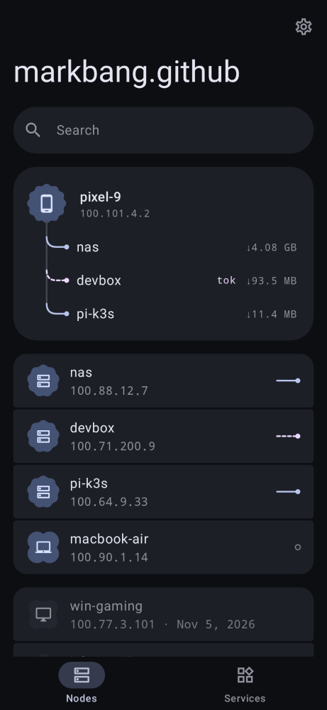
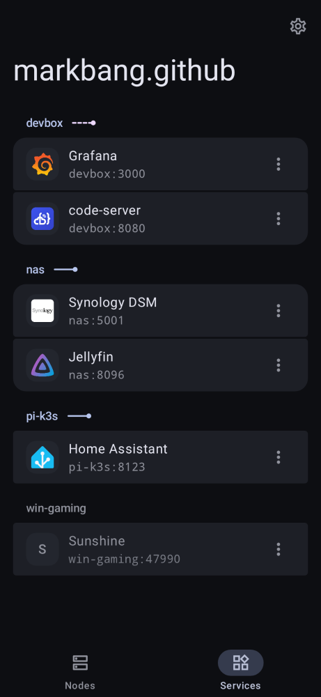
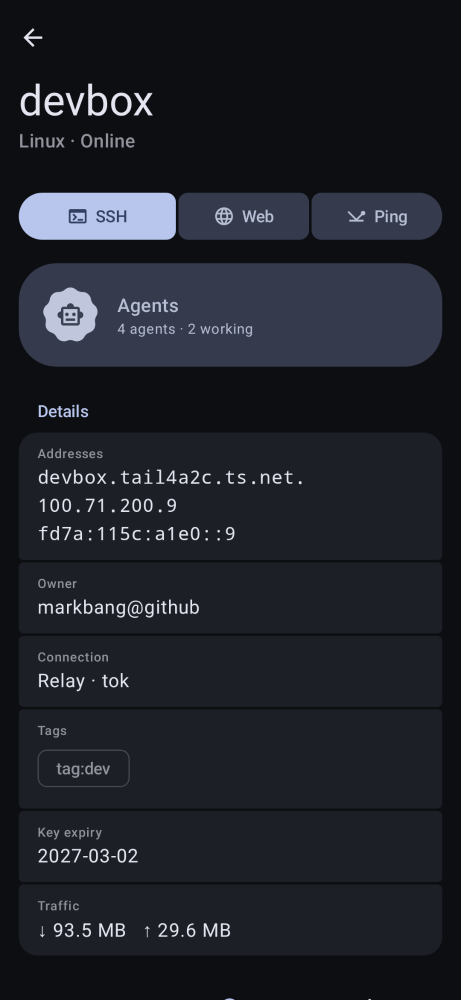
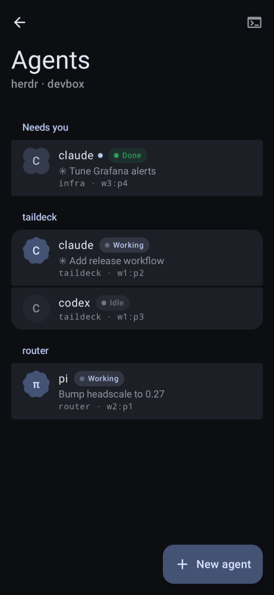
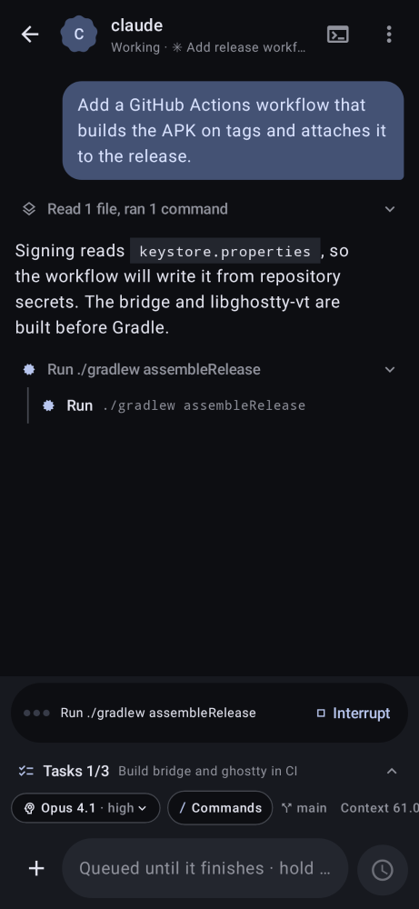

# Taildeck

English · [中文](README.zh-CN.md)

<p>
  
  
  
  
  
</p>

An Android app for the machines in your tailnet. It runs its own Tailscale node inside the app (via [SagerNet/tailscale](https://github.com/SagerNet/tailscale) `tsnet`), so it doesn't use the VPN slot and doesn't affect other apps.

- Sign in with Tailscale or a Headscale control server (browser login or auth key)
- Node list with online state, OS, addresses, tags, routes, direct/relay path and ping
- Per-node services: add manually or scan common ports, open them in the app with plain `node:port` addresses, or in your default browser (cookies and saved passwords shared with it)
- Built-in SSH terminal on [libghostty-vt](https://github.com/ghostty-org/ghostty) with a native renderer: Tailscale SSH, password, the built-in ed25519 key, or imported keys (passphrase-protected keys and OpenSSH certificates supported)

The in-app WebView uses the gateway on `127.0.0.1:18680` as a forward proxy (tailnet hosts go through the node, everything else direct). External browsers reach the tailnet through the same gateway: `http://<node>-<port>.localhost:18680/` (append `s` to the port for HTTPS services, e.g. `nas-5001s`). Each service gets its own origin. The gateway skips TLS verification for upstream services and is reachable by any app on the device.

## Download

Latest release: [v0.1.0](https://github.com/markbang/taildeck/releases/tag/v0.1.0) — arm64-v8a, x86_64 and universal APKs.

## Flutter rewrite

A Flutter rewrite for Android, iOS, Windows, Linux and macOS lives in [markbang/taildeck-ui](https://github.com/markbang/taildeck-ui); its Web build is a UI preview only.

## Build

Requirements: Go 1.26+, `gomobile`, Zig 0.17, JDK 17+, Android SDK 36, NDK r28, CMake 3.31.

```sh
go install golang.org/x/mobile/cmd/gomobile@latest
./bridge/build.sh                      # -> android/app/libs/tsbridge.aar
./term/build-ghostty.sh                # -> android/app/src/main/cpp/ghostty
cd android && ./gradlew assembleRelease
```

The release build is signed with the debug key. Change `signingConfig` before distributing it.
