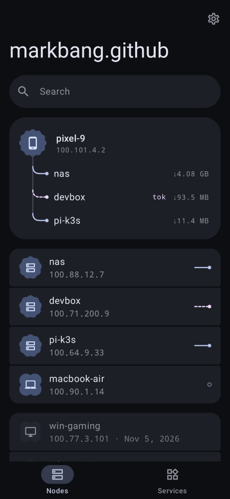
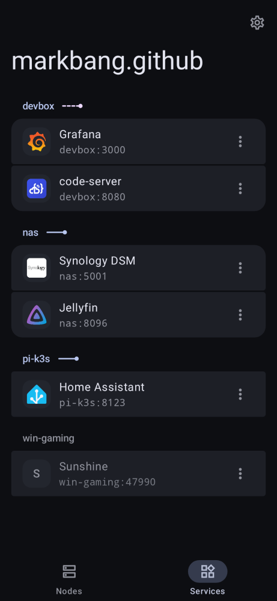
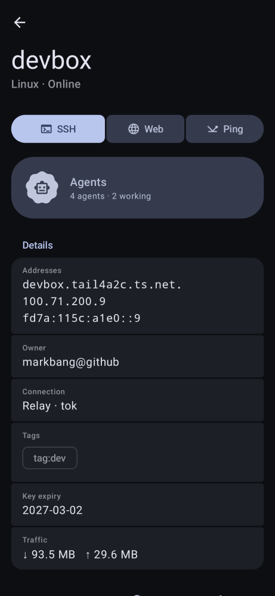
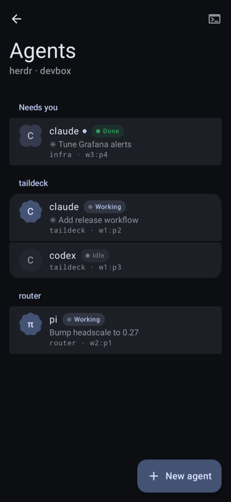
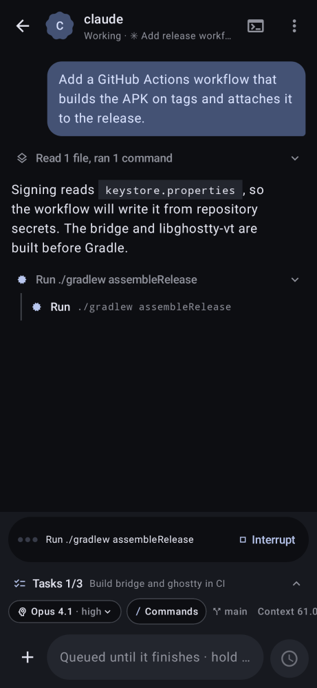

# Taildeck

[English](README.md) · 中文

<p>
  
  
  
  
  
</p>

管理 Tailnet 内机器的 Android App。App 内通过 [SagerNet/tailscale](https://github.com/SagerNet/tailscale) 的 `tsnet` 运行独立的 Tailscale 节点，不占用系统 VPN，也不影响其他 App。

- 支持 Tailscale 官方或 Headscale 控制服务器，可浏览器登录或使用 Auth Key
- 节点列表：在线状态、系统、地址、标签、子网路由、直连或中继、Ping
- 节点服务：手动添加或扫描常用端口，在 App 内直接用 `节点:端口` 地址打开，或用系统默认浏览器打开（Cookie 和保存的密码与浏览器共用）
- 内置 SSH 终端，基于 [libghostty-vt](https://github.com/ghostty-org/ghostty)，原生渲染：支持 Tailscale SSH、密码、内置 ed25519 密钥，以及导入的私钥（支持密码短语和 OpenSSH 证书）

App 内 WebView 以 `127.0.0.1:18680` 网关作为正向代理（Tailnet 地址走节点，其余直连）。外部浏览器也通过同一个网关访问 Tailnet：`http://<节点>-<端口>.localhost:18680/`（HTTPS 服务在端口后加 `s`，如 `nas-5001s`）。每个服务是独立的源。网关不校验上游服务的 TLS 证书，且本机任何 App 都能访问它。

## 下载

最新版本：[v0.1.0](https://github.com/markbang/taildeck/releases/tag/v0.1.0)，提供 arm64-v8a、x86_64 和 universal 三种 APK。

## Flutter 重写版

面向 Android、iOS、Windows、Linux 和 macOS 的 Flutter 重写版在 [markbang/taildeck-ui](https://github.com/markbang/taildeck-ui)；它的 Web 构建只是界面预览。

## 构建

需要 Go 1.26+、`gomobile`、Zig 0.17、JDK 17+、Android SDK 36、NDK r28、CMake 3.31。

```sh
go install golang.org/x/mobile/cmd/gomobile@latest
./bridge/build.sh                      # 生成 android/app/libs/tsbridge.aar
./term/build-ghostty.sh                # 生成 android/app/src/main/cpp/ghostty
cd android && ./gradlew assembleRelease
```

Release 包用 debug 密钥签名，正式分发前请修改 `signingConfig`。
